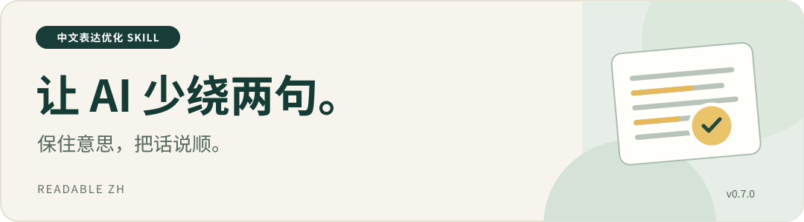

# Readable ZH



给 Codex、Claude Code 用的中文写作 Skill。理顺绕句、指代和重复，让日常消息、技术说明、科研交流更自然、更好懂。

[开始使用](#安装) · [更多用法](docs/usage.md) · [下载安装包](https://github.com/HMartians587/readable-zh/releases/latest/download/readable-zh.zip) · [反馈一句别扭的话](https://github.com/HMartians587/readable-zh/issues/new/choose)

## 这句话，能不能少绕一点？

**绕了一圈：**

> 在上传文件这一操作环节中，对于文件大小超过 10 MB 的情况，需要先进行压缩，然后再执行上传操作；文件大小未超过 10 MB 时，则可以直接上传。

**说清楚：**

> 超过 10 MB 的文件，先压缩，再上传。不超过 10 MB 的，可以直接上传。

这是一组编辑示意。条件和动作都在，读者不用在句子里找路。

Readable ZH 会检查哪些地方真正在妨碍阅读，再决定怎样改。原本顺畅的表达可以留下。

## 文字可以变，意思得在

“计划下月测试”仍然是计划；“只测过一次”不能写成稳定提升。数字、条件、范围和作者的态度，都要跟着改稿一起留下。

你可以让它润色一条消息、审阅一段解释、重排一份报告，也可以根据给定材料从头写。正式报告保持正式，熟人消息保留自然的省略和语气。

## 安装

需要 Node.js 22.20 或以上版本。在项目目录运行：

```sh
npx skills add HMartians587/readable-zh --skill readable-zh
```

按提示选择 Codex 或 Claude Code。默认安装到当前项目，添加 `-g` 可安装为全局技能。

安装好，给它一句请求和你的原文：

```text
使用 $readable-zh 润色下面这段话，保留原意，直接给我成稿：

……
```

Codex 用 `$readable-zh`；Claude Code 独立技能用 `/readable-zh`。

<details>
<summary><strong>在 Claude Code 中按插件安装</strong></summary>

在 Claude Code 会话中运行：

```text
/plugin marketplace add HMartians587/readable-zh
/plugin install readable-zh@readable-zh
```

以插件方式安装后，用 `/readable-zh:readable-zh` 调用。插件与独立技能包含相同写作指导。

</details>

<details>
<summary><strong>手动安装</strong></summary>

下载[技能安装包](https://github.com/HMartians587/readable-zh/releases/latest/download/readable-zh.zip)，或复制整个 [`skills/readable-zh`](skills/readable-zh) 文件夹，放到对应目录：

| 宿主 | 用户级目录 | 项目级目录 |
| --- | --- | --- |
| Codex | `~/.agents/skills/readable-zh` | `.agents/skills/readable-zh` |
| Claude Code | `~/.claude/skills/readable-zh` | `.claude/skills/readable-zh` |

保留文件夹内的入口、参考文件和许可。安装机制见 [Codex 官方说明](https://learn.chatgpt.com/docs/build-skills)、[Claude Code 官方说明](https://code.claude.com/docs/en/skills)。命令行安装使用 [Skills CLI](https://github.com/vercel-labs/skills)。

</details>

## 按你要做的事来用

只想改一句话，直接贴原文。需要保持文风，就带一小段自己的样本；讨论实验，就提供结果和影响判断的设置。

日常沟通、技术说明、科研交流，以及只审阅、局部编辑、根据材料写作的完整提示词，都在[使用指南](docs/usage.md)。

Readable ZH 是纯文本技能，由你使用的模型执行，无需另外搭建服务器。当前版本 **0.7.0**，技能入口见 [SKILL.md](skills/readable-zh/SKILL.md)。

## 带一句让你皱眉的话来

欢迎在 [Issues](https://github.com/HMartians587/readable-zh/issues) 留下具体句子：原文是什么、改成了什么、哪里读着不舒服。也欢迎修正文档或提交改进，见[贡献指南](CONTRIBUTING.md)。

[MIT 许可](LICENSE) · [来源说明](docs/source-map.md) · [第三方许可](THIRD_PARTY_NOTICES.md)
